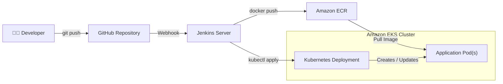

# Automated Application Deployment to AWS EKS via Jenkins CI/CD

This project demonstrates continuous integration and continuous delivery (CI/CD) best practices by packaging a containerized application, pushing it to Amazon Elastic Container Registry (ECR), and deploying it into a managed Kubernetes cluster.

The AWS EKS cluster and Jenkins server are built from scratch to get an insight on how their configurations tie up with the end goal.

---

## 🏛️ Architecture Overview



1. Developer pushes code to GitHub repository.
2. Webhook triggers the Jenkins pipeline build.
3. Jenkins compiles the app, runs unit tests, and builds a Docker image.
4. Image is pushed to Amazon Elastic Container Registry (ECR).
5. Pipeline executes `kubectl` deployments to update the Amazon EKS cluster.

---

## 🛠️ Tech Stack

* **Cloud Provider:** AWS (EKS, ECR, IAM, VPC), Digital Ocean (Jenkins)
* **CI/CD Orchestration:** Jenkins
* **Containerization & Orchestration:** Docker, Kubernetes
* **Infrastructure as Code (IaC):** Terraform / eksctl / AWS CLI

---

## ✔ Prerequisites 
* AWS CLI configured with administrative access
* `kubectl` (for cluster manangement)
* Running Jenkins server with AWS, Docker, and Kubernetes plugins installed

---

## 🚀 Setup & Deployment Guide

### Phase 1: Provisioning the Amazon EKS Cluster
1. On creating the EKS cluster, the command-line tool `eksctl` is preferred over the AWS UI and the AWS CLI for efficiency and reproducibility reasons - the roles and VPC are created in the background which would otherwise have been created manually with the AWS UI or CLI. 
2. `eksctl` is installed on the local machine that will be used to communicate with AWS
3. While creating the cluster, we override the default values of the command as follows:
```bash
eksctl create cluster \
  --name my-eks-cluster \
  --version 1.27 \
  --region us-west-2 \
  --nodegroup-name demo-nodes \
  --node-type t2.micro \
  --nodes 2 \
  --nodes-min 1 \
  --nodes-max 3 \
```


### Phase 2: Jenkins Installation and Pipeline Configuration
Installing Jenkins on Digital Ocean Droplet:
* Prerequisites
  *Environment variables and credentials setup (AWS Keys, Kubeconfig)
* Webhook integration with GitHub

Setting up Jenkins to interact with AWS and EKS:
* Install kubectl command line tool inside Jenkins container
* Webhook integration with GitHub
---

## ⚙️ Jenkins Pipeline Structure (`Jenkinsfile`)

Explain the breakdown of your pipeline stages:

* **Stage 1: Code Checkout & Static Analysis** – Pulls latest code and runs linting/tests.
* **Stage 2: Build Docker Image** – Builds the image with dynamic commit tag.
* **Stage 3: Push to Amazon ECR** – Authenticates with AWS ECR and pushes the image.
* **Stage 4: Deploy to EKS** – Updates deployment manifests with the new image tag and executes `kubectl apply`.
* **Stage 5: Verification** – Verifies rollout status (`kubectl rollout status`).

---

## 🔍 Verification & Testing

* Commands to review created EKS cluster (`kubectl get nodes`)
* Commands to check deployment status (`kubectl get pods`, `kubectl get svc`)
* Accessing the deployed application via LoadBalancer URL or Ingress controller

---

# 🗒️ DevOps Learning Log: Challenges & Solutions

## 🔍 Challenge: Jenkins Pipeline "Permission Denied" on Docker Socket

### 🚨 The Problem
When running a **Docker-outside-of-Docker (DooD)** setup—where a Jenkins container needs to build Docker images using the host's Docker daemon via a mounted volume (`-v /var/run/docker.sock:/var/run/docker.sock`)—pipelines fail with the following error:

```text
Got permission denied while trying to connect to the Docker daemon socket at unix:///var/run/docker.sock
```

### ❌ The "Trap" Solution (Why `chmod 666` Fails)
Running `sudo chmod 666 /var/run/docker.sock` on the host machine makes the error go away instantly. **However, this introduces two major issues:**
1. **Security Risk:** It grants universal read/write access to the Docker socket. Anyone or any process on the server can easily escalate privileges to root.
2. **Ephemeral Fix:** Every time the **host VM restarts** or the Docker service reboots, the system automatically resets the socket permissions back to `660`. The pipeline breaks all over again.

---

### ✅ The Permanent Solution: `--group-add`
Instead of altering host permissions, dynamically pass the host's Docker Group ID (GID) directly to the Jenkins container at startup using the `--group-add` flag.

#### Step-by-Step Implementation

1. **Find the Host's Docker GID**  
   Run this command on your host machine (e.g., DigitalOcean VM) to find the exact ID number for the `docker` group:
   ```bash
   getent group docker | cut -d: -f3
   ```
   *(For example, the output in my case was `112`)*

2. **Run the Jenkins Container with Supplementary Group Privileges**  
   Append the `--group-add` flag to your `docker run` command. This grants the container's non-root `jenkins` user permission to use the socket safely and permanently.

   ```bash
   docker run -d \
     --name jenkins \
     -p 8080:8080 -p 50000:50000 \
     -v jenkins_home:/var/jenkins_home \
     -v /var/run/docker.sock:/var/run/docker.sock \
     --group-add 112 \
     jenkins/jenkins:lts
   ```

   > 💡 **DevOps Tip:** To make the script completely dynamic across different servers, you can bake the GID lookup command right into the docker run command:
   > ```bash
   > --group-add "$(getent group docker | cut -d: -f3)"
   > ```

### 🧠 Lessons Learned
* **Never use `chmod 666` on system sockets.** Temporary workarounds create configurations that vanish on reboot and expose the entire host server.
* **Understand Group IDs across boundaries.** Containers and hosts map file permissions by numerical GIDs, not user names. `--group-add` bridges this gap cleanly.

--- 
## 🧹 Cleanup

Document the tear-down steps to ensure no unexpected AWS costs:
`eksctl delete cluster --name <cluster-name>` or `terraform destroy`

