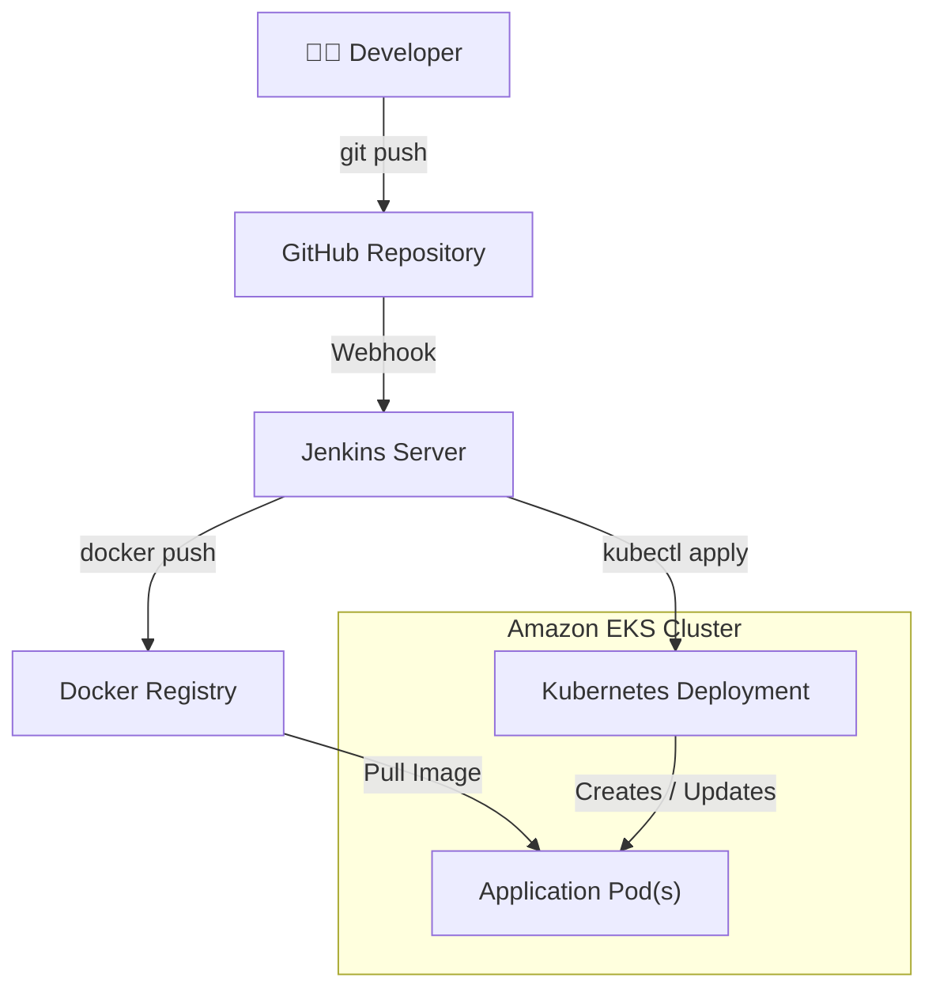

# Complete Jenkins CI/CD Pipeline with AWS EKS and DockerHub 

This project demonstrates continuous integration and continuous delivery (CI/CD) best practices by packaging a containerized application, pushing it to DockerHub, and deploying it into a managed Kubernetes cluster.


---

## 🏛️ Architecture Overview



1. Developer pushes code to GitHub repository.
2. Webhook triggers the Jenkins pipeline build.
3. Jenkins compiles the app, runs unit tests, and builds a Docker image.
4. Image is pushed to DockerHub Registry.
5. Pipeline executes `kubectl` deployments to update the Amazon EKS cluster.

---

## 🛠️ Tech Stack

* **Cloud Provider:** AWS (EKS, IAM, VPC), Digital Ocean (Jenkins)
* **CI/CD Orchestration:** Jenkins
* **Containerization & Orchestration:** Docker, Kubernetes


---

## ✔ Prerequisites 
* AWS CLI configured with administrative access
* `kubectl` (for cluster manangement)
* Running Jenkins server with webhook integration to Github as well as AWS, Docker, and Kubernetes plugins installed. 
The server should also have `envsubst` tool installed. This tool passes the environment variable values from the Jenkins file to the deployment and service files
* EKS cluster


## ⚙️ Adjust Jenkins Pipeline Structure (`Jenkinsfile`) for EKS Cluster Deployment

Jenkins is set up to interact with AWS and EKS. Below is the breakdown of your pipeline stages:

* **Stage 1: Increment Version** – Pulls latest code and runs linting/tests.
* **Stage 2: Clean Up** – Cleans previous artifacts.
* **Stage 3: Build Image** – Builds image. Authenticates with DockerHub and pushes the image.
* **Stage 4: Deploy to EKS** – Executes `kubectl apply` on the deployment and service files.
* **Stage 5: Commit Version Update** – Commit and push changes to the repository.

---

## 🔍 Verification & Testing

* Commands to review created EKS cluster (`kubectl get nodes`)
* Commands to check deployment status (`kubectl get pods`, `kubectl get svc`)
* Accessing the deployed application via LoadBalancer URL or Ingress controller

---

# 🗒️ DevOps Learning Log: Challenges & Solutions

## 🔍 Challenge: CI/CD Pipeline Freezing at the Build Stage

### 🚨 The Problem
The CI/CD pipeline gets interrupted by Jenkins container restarts


### ❌ The Root Cause
Inspected recent logs of the Jenkins container using the command:
```bash
docker logs --tail 100 jenkins
```
The output indicated that the Jenkins container was becoming unresponsive due to severe memory exhaustion on the host. The conclusion comes from the pattern of symptoms in the logs. The strongest indicators are these repeated lines:
* `DurableTaskStep [#62]: checking /var/jenkins_home/workspace/my-pipeline on unresponsive for 12 min`
* `jenkins.metrics.api.Metrics$HealthChecker thread is still running. Execution aborted.`

The pipeline becomes unresponsive because during builds Maven, Java compilation, Docker builds and Jenkins itself consume RAM all on a 1 vCPU, 1 GB RAM VM. Subsquently, when memory pressure becomes too high: 
* Linux begins swapping heavily
* processes stall
* Jenkins threads stop responding
* pipeline steps become “unresponsive”
* eventually the JVM (Java Virtual Machine)struggles to execute scheduled work and crashes or is OOM-killed
* Docker restart policy restarts the container

Whereas a 1 GB server is sufficient for small learning projects, it is usually too small or Java + Docker workloads

---

### ✅ The Solution: Server Upgrade
Upgraded the Digital Ocean droplet hosting the Jenkins container from `1 vCPU - 512 MB RAM - 10 GB SSD - 500 GB Transfer` to `2 vCPU - 4 GB RAM - 80 GB SSD - 4 TB Transfer`

### 🧠 Lessons Learned

1. **Understanding Groovy Variables and Environment Variables**

An important distinction in Jenkins Pipeline scripting is the difference between ordinary Groovy variables and environment variables.

**Groovy variables**

* Declared using def.

* Used to store and manipulate data within Groovy code.

* Their accessibility depends on where they are declared and their scope.

* They are not automatically available to shell processes.

**Example:**

`def matcher = readFile('pom.xml') =~ '<version>(.+)</version>'`
`def version = matcher[0][1]`

Here, readFile() reads the Maven pom.xml file, while the regular expression extracts the application version. The result is stored in the Groovy variable version.

**Environment variables**

* Store configuration and values that Jenkins makes available to pipeline steps.

* Can be declared in the Declarative Pipeline environment block.

* Are accessible to shell processes launched by Jenkins.

* Can also be accessed and modified in Groovy using the env object.

**Example:**
```groovy
environment {
    DOCKER_REPO_SERVER = '541372248110.dkr.ecr.eu-west-2.amazonaws.com'
    DOCKER_REPO = "${DOCKER_REPO_SERVER}/java-maven-app"
}
```
An environment variable can also be assigned dynamically:

`env.IMAGE_VERSION = version`

This makes the extracted Maven version available to subsequent pipeline steps and shell commands.

2. **Understanding Groovy String Interpolation**

String interpolation is the process of inserting the value of a variable into a string.

Groovy supports interpolation in double-quoted strings (GStrings).

Both expressions below are valid:

`def name = "Mickey"`

`echo "Hello ${name}"`
`echo "Hello $name"`

Both produce:

`Hello Mickey`

Curly braces are optional in simple variable references but are useful for clearly delimiting variable names.

For example:

`"${IMAGE_NAME}_VERSION"`

Here, the curly braces distinguish IMAGE_NAME from the literal _VERSION suffix.

3. **Understanding Single and Double Quotes in Jenkins Shell Commands**

Jenkins Pipeline uses Groovy, but commands executed through the sh step are interpreted by the operating system's shell (typically Bash or another POSIX-compatible shell).

The choice of quotation marks determines whether Groovy interpolates variables before passing the command to the shell.

**Double-quoted Groovy string:**

`sh "echo ${IMAGE_VERSION}"`

Groovy interpolates the variable before passing the resulting command to the shell.

**Single-quoted Groovy string:**

`sh 'echo "${IMAGE_VERSION}"'`

Groovy passes the variable reference unchanged. The shell subsequently expands ${IMAGE_VERSION} using its environment.

An important distinction is that both Groovy and Bash understand $VARIABLE and ${VARIABLE} syntax. Curly braces are not exclusive to Groovy.

4. **Secure Handling of Credentials**

When handling sensitive information such as passwords, API tokens and registry credentials, avoid Groovy interpolation.

For example, instead of:

`sh "echo ${PASS} | docker login -u ${USER} --password-stdin ${DOCKER_REPO_SERVER}"`

Prefer:

`sh 'echo "$PASS" | docker login -u "$USER" --password-stdin "$DOCKER_REPO_SERVER"'`

This allows the shell to expand the credential environment variables rather than having Groovy interpolate sensitive values into the command.

Jenkins recommends this approach to reduce the risk of exposing credentials through process arguments and logs.

5. **Key Takeaways**

* def declares an ordinary Groovy variable.

* `environment {}` declares Jenkins environment variables.

* env.VARIABLE accesses or assigns Jenkins environment variables from Groovy.

* Groovy interpolation inserts variable values into double-quoted strings.

* Single-quoted Groovy strings prevent Groovy interpolation.

* The shell can independently expand environment variables using $VARIABLE or ${VARIABLE}.

* Prefer single-quoted Groovy strings for sh commands, particularly when handling credentials.

* Jenkins Pipeline combines Groovy scripting with shell execution; understanding which interpreter handles each expression is essential.

**Overall lesson:** Groovy prepares and controls the pipeline, while the shell executes operating-system commands. Understanding the boundary between these two environments makes Jenkinsfiles easier to read, debug and maintain.

--- 
## 🧹 Cleanup

Document the tear-down steps to ensure no unexpected AWS costs:
`eksctl delete cluster --name <cluster-name>` or `terraform destroy`

